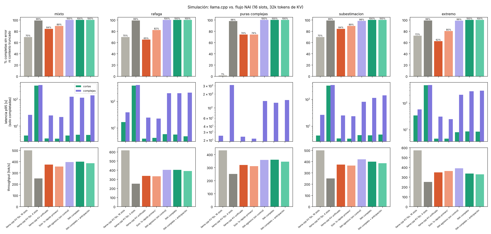

# Motor NAI para llama.cpp

**Inercia latente, autopista de muestreo, memoria gravitatoria del KV cache, desalojo selectivo, sesiones persistentes de 24 h, memoria reconstructiva por regiones y un planificador de memoria entrelazado (en diseño).**

NAI es una extensión de [llama.cpp](https://github.com/ggml-org/llama.cpp) creada por **Ángelus Tenshi (Francisco Alejandro Cruz Castro)**. Parte de una idea: *gastar cómputo y memoria según cuánta información aporta cada token*, inspirada en principios físicos (inercia, gravedad, disipación). El marco teórico original está en [VISION.md](VISION.md). Este documento describe **lo que hace el código hoy**: cómo descargarlo, compilarlo, ejecutarlo, las fórmulas exactas que implementa, cómo medirlo y cómo modificarlo sin romper nada.

> **Autoría:** la idea, el marco teórico, los cálculos, la lógica y las reglas de negocio de NAI son de Ángelus Tenshi (Francisco Alejandro Cruz Castro). Ver [§14](#14-lógica-cálculos-y-reglas-de-negocio-del-autor) y [§15](#15-autoría-y-cómo-citar).

> **Principio de diseño:** todas las funciones NAI están **desactivadas por defecto**. Sin flags, el motor se comporta exactamente como llama.cpp. Cada función se activa con su propio flag y se puede medir por separado contra la versión sin ella.

## Índice

1. [Inicio rápido](#1-inicio-rápido)
2. [Descarga e instalación](#2-descarga-e-instalación)
3. [Ejecución](#3-ejecución)
4. [Funciones y flags](#4-funciones-y-flags)
5. [Fundamentos matemáticos](#5-fundamentos-matemáticos)
6. [Resultados medidos](#6-resultados-medidos)
7. [Cómo medir](#7-cómo-medir)
8. [Arquitectura del código](#8-arquitectura-del-código)
9. [Guía para desarrolladores](#9-guía-para-desarrolladores)
10. [Solución de problemas](#10-solución-de-problemas)
11. [Limitaciones y trabajo pendiente](#11-limitaciones-y-trabajo-pendiente)
12. [Trabajo relacionado](#12-trabajo-relacionado)
13. [Casos prácticos y campos de aplicación](#13-casos-prácticos-y-campos-de-aplicación)
14. [Lógica, cálculos y reglas de negocio del autor](#14-lógica-cálculos-y-reglas-de-negocio-del-autor)
15. [Autoría y cómo citar](#15-autoría-y-cómo-citar)

---

## 1. Inicio rápido

En macOS con Apple Silicon (en Linux cambia solo el paso de dependencias, ver §2):

```console
xcode-select --install
brew install cmake git
git clone https://github.com/FranciscoACruz/NAIEngine-llama.cpp.git
cd NAIEngine-llama.cpp
cmake -B build -DCMAKE_BUILD_TYPE=Release
cmake --build build -j 4 --target llama-server llama-cli test-nai
./build/bin/test-nai
curl -L -o qwen2.5-0.5b-instruct-q4_k_m.gguf https://huggingface.co/Qwen/Qwen2.5-0.5B-Instruct-GGUF/resolve/main/qwen2.5-0.5b-instruct-q4_k_m.gguf
./build/bin/llama-server -m qwen2.5-0.5b-instruct-q4_k_m.gguf --port 8080 --nai-sesiones ./sesiones --context-shift --nai-desalojo
```

Abre `http://localhost:8080` en el navegador o usa la API (§3.2).

---

## 2. Descarga e instalación

### 2.1 Requisitos

| Componente | Mínimo | Notas |
|---|---|---|
| Compilador C++17 | Clang 14, GCC 11, MSVC 2022 | En macOS viene con las Command Line Tools |
| CMake | 3.14 | `brew install cmake` / `apt install cmake` |
| Python 3 | 3.9 | Solo para las herramientas de `tools/nai/` y `crear_modelo_prueba.py` (`pip install numpy gguf`) |
| RAM | 4 GB | Modelo 0.5B Q4 ≈ 0.4 GB; 3B Q4 ≈ 2 GB. Con 8 GB compila con `-j 2` |
| Disco | ~2 GB | Código + compilación + un modelo pequeño |

El software no está atado a una arquitectura: el mismo código corre en CPU (x86, ARM), Metal (Apple), CUDA (NVIDIA), Vulkan y los demás backends de ggml. Las funciones NAI trabajan sobre los logits y sobre la máscara de atención, que existen en todos los backends.

### 2.2 Descargar el código

```console
git clone https://github.com/FranciscoACruz/NAIEngine-llama.cpp.git
cd NAIEngine-llama.cpp
```

Para actualizar después: `git pull`.

### 2.3 Dependencias por sistema

**macOS:**

```console
xcode-select --install
brew install cmake
```

**Ubuntu / Debian:**

```console
sudo apt update
sudo apt install -y build-essential cmake git python3-pip
```

**Windows:** instala Visual Studio 2022 con "Desarrollo para escritorio con C++" y CMake, y usa la "Developer PowerShell".

### 2.4 Compilar

Compilación estándar (detecta Metal en Apple Silicon automáticamente):

```console
cmake -B build -DCMAKE_BUILD_TYPE=Release
cmake --build build -j 4 --target llama-server llama-cli test-nai nai_medir_capas nai_memoria
```

Variantes según el hardware:

| Hardware | Configuración |
|---|---|
| Apple Silicon (Metal) | `cmake -B build -DCMAKE_BUILD_TYPE=Release` |
| Solo CPU | `cmake -B build -DCMAKE_BUILD_TYPE=Release -DGGML_METAL=OFF` |
| NVIDIA | `cmake -B build -DCMAKE_BUILD_TYPE=Release -DGGML_CUDA=ON` |
| Vulkan (AMD, Intel, NVIDIA) | `cmake -B build -DCMAKE_BUILD_TYPE=Release -DGGML_VULKAN=ON` |
| Equipos con poca RAM (≤ 8 GB) | Igual, pero compila con `-j 2` en lugar de `-j 4` |

Los binarios quedan en `build/bin/`. En Windows, en `build\bin\Release\`.

### 2.5 Verificar la instalación

```console
./build/bin/test-nai
```

No necesita modelo y debe terminar sin fallos. Cubre entropía, sorpresa, `exp_rapido`, log-sum-exp con NaN, predicciones pendientes, mapa de masa, ventana de desalojo, telemetría concurrente, triaje, SipHash-2-4 (vectores oficiales) y la tabla de sesiones. También corre con `ctest --test-dir build -R test-nai --output-on-failure`.

### 2.6 Descargar un modelo

NAI usa modelos GGUF, igual que llama.cpp. Para empezar, Qwen2.5 Instruct en Q4_K_M:

```console
curl -L -o qwen2.5-0.5b-instruct-q4_k_m.gguf https://huggingface.co/Qwen/Qwen2.5-0.5B-Instruct-GGUF/resolve/main/qwen2.5-0.5b-instruct-q4_k_m.gguf
curl -L -o qwen2.5-3b-instruct-q4_k_m.gguf https://huggingface.co/Qwen/Qwen2.5-3B-Instruct-GGUF/resolve/main/qwen2.5-3b-instruct-q4_k_m.gguf
```

Para pruebas sin descargar nada hay un generador de modelos aleatorios diminutos (la salida no tiene sentido, pero ejercita todo el motor):

```console
pip3 install numpy gguf
python3 tests/nai-manual/crear_modelo_prueba.py /tmp/nai-prueba.gguf
```

Con `--capas 24 --embd 896 --cabezas 14 --cabezas-kv 2 --ff 4864 --f16 --vocab models/ggml-vocab-qwen2.gguf` crea un modelo aleatorio con la forma exacta de Qwen2.5-0.5B, útil para medir costos reales por token.

---

## 3. Ejecución

### 3.1 Servidor

```console
./build/bin/llama-server -m qwen2.5-0.5b-instruct-q4_k_m.gguf --port 8080 -c 8192 --context-shift --nai-desalojo --nai-sesiones ./sesiones --nai-sesion-ttl 86400
```

Expone la interfaz web en `http://localhost:8080` y una API compatible con OpenAI en `/v1/chat/completions`.

### 3.2 API con sesión persistente

Cada petición puede llevar `"nai_session"`. El backend que llama al servidor genera el id (aleatorio, ≥ 128 bits) y lo asocia al usuario autenticado:

```console
SESION=$(openssl rand -hex 16)
curl http://localhost:8080/v1/chat/completions -H "Content-Type: application/json" -d "{\"nai_session\":\"$SESION\",\"messages\":[{\"role\":\"user\",\"content\":\"Hola, me llamo Ana\"}]}"
```

Si el servidor se reinicia o el slot se reutiliza, la siguiente petición con el mismo id restaura el KV cache del disco en lugar de reprocesar toda la conversación (§5.8).

### 3.3 Línea de comandos

```console
./build/bin/llama-cli -m qwen2.5-0.5b-instruct-q4_k_m.gguf --nai-triaje --nai-autopista
```

### 3.4 Herramientas de medición (requieren modelo)

```console
./build/bin/nai_medir_capas -m qwen2.5-0.5b-instruct-q4_k_m.gguf -n 64
./build/bin/nai_memoria -m qwen2.5-3b-instruct-q4_k_m.gguf -c "lápiz"
python3 tools/nai/nai_bench.py -m qwen2.5-0.5b-instruct-q4_k_m.gguf --rondas 3 --reps 3
```

---

## 4. Funciones y flags

| Función | Flag | Por defecto | ¿Cambia la salida? | Qué hace |
|---|---|---|---|---|
| Autopista de muestreo | `--nai-autopista` | apagada | **No** con temp 0. Con temp > 0, error acotado por `1 − p_min` | Devuelve el top-1 sin recorrer la cadena de samplers cuando el resultado ya está decidido |
| Umbral de la autopista | `--nai-autopista-p-min P` | `0.99` | — | Probabilidad mínima del top-1 para tomar el atajo con temp > 0. Rango (0, 1] |
| Desalojo selectivo | `--context-shift --nai-desalojo` | apagado | Solo cuando el contexto se llena | En el *context shift* descarta la ventana de **menor masa** en lugar de la más antigua |
| Memoria gravitatoria *(experimental)* | `--nai-gravedad γ` | `0` (apagada) | **Sí** | Atenúa la atención hacia tokens generados de poca masa: sesgo `−γ·Δt/(masa+ε)` |
| Suavizado de la gravedad | `--nai-gravedad-eps ε` | `0.05` | — | Evita dividir entre cero en masas muy bajas. Debe ser > 0 |
| Sesiones persistentes | `--nai-sesiones DIR` | apagadas | No | Guarda y restaura el KV cache de cada conversación |
| Caducidad de sesiones | `--nai-sesion-ttl SEG` | `86400` (24 h) | — | Segundos sin actividad tras los que la sesión y su archivo se eliminan |
| Triaje (CLI) | `--nai-triaje` | apagado | Solo pide aclaración | Detecta peticiones cortas y ambiguas y pregunta antes de generar |
| Traza del planificador | `--nai-traza PREFIJO` | apagada | No | Escribe CSV por paso y por petición para calibrar el simulador del planificador |
| Auto-especulación por capas | `-md borrador.gguf` | — | **No** | Borrador = primeras K capas del modelo, verificado por el modelo completo |

> Verifica el valor por defecto exacto de cada flag con `./build/bin/llama-server --help | grep nai`.

---

## 5. Fundamentos matemáticos

Notación: $V$ es el vocabulario, $z \in \mathbb{R}^{|V|}$ los logits de una posición, $p = \mathrm{softmax}(z)$, $x_i$ el token en la posición $i$, $L$ el número de capas.

### 5.1 Masa semántica (`src/inercia_latente.hpp`)

La masa de un token es la **sorpresa normalizada** del token que realmente quedó en esa posición:

$$I_i = \frac{-\ln p(x_i \mid x_{\lt i})}{\ln |V|} = \frac{\mathrm{LSE}(z^{(i-1)}) - z^{(i-1)}_{x_i}}{\ln |V|} \in [0, 1]$$

donde $\mathrm{LSE}(z) = \ln \sum_v e^{z_v}$. El resultado se recorta a $[0, 1]$.

- **Masa baja:** el token era predecible (relleno, o algo que ya está en el contexto). Es candidato a desalojo o atenuación.
- **Masa alta:** el token aportó información nueva y se conserva.
- **Protegida ($I = 1$, `MASA_PROTEGIDA`):** posiciones sin predicción medida: el prompt y el mensaje de sistema. Nunca se desalojan ni se atenúan antes que el texto generado.

**Predicciones pendientes.** Los logits de la posición $i-1$ predicen el token $i$, que todavía no existe cuando se calculan. Por eso, tras cada `decode`, el contexto guarda $\mathrm{LSE}(z^{(i-1)})$ y el vector de logits necesario como *predicción pendiente* de la secuencia, y cuando llega el token $x_i$ calcula $I_i$ y la escribe **en la posición $i$**. Guardarla en $i-1$ (el error de versiones anteriores) asigna la sorpresa al token equivocado.

Corresponde al término $\mathcal{H}_{\text{local}}$ de VISION.md medido sobre el token mismo. El factor $\|W_K x_i\|_2$ de la fórmula original está pendiente (§11).

### 5.2 Log-sum-exp rápido y su cota de error

Calcular $\mathrm{LSE}$ sobre 152 000 logits por token es el costo principal del mapa de masa. NAI usa dos aproximaciones con error acotado:

**Corte a $C = 16$ nats** (`NAI_LSE_CORTE`). Con $m = \max_v z_v$:

$$\mathrm{LSE}(z) = m + \ln \sum_v e^{z_v - m} \approx m + \ln \sum_{z_v - m \gt  -C} e^{z_v - m}$$

Cada término omitido vale menos de $e^{-16} \approx 1.1 \times 10^{-7}$ y la suma conservada es $\ge 1$ (incluye $e^0$), así que el error es como máximo $\ln(1 + |V| e^{-C})$. Con $|V| = 152\,000$ eso es $\le 0.017$ nats, es decir $\le 0.0015$ en masa normalizada ($\div \ln|V| \approx 11.9$). En la práctica, con logits con pico, el error es $\lt  10^{-4}$ nats.

**`exp_rapido` sin ramas.** Para $x \le 0$:

$$e^x = 2^{t}, \quad t = x \log_2 e, \quad 2^t = 2^{n} \cdot 2^{f}, \quad n = \lfloor t \rfloor,\ f = t - n \in [0, 1)$$

$2^n$ se arma escribiendo directamente el exponente IEEE-754 ($(n + 127) \ll 23$) y $2^f$ se evalúa con un polinomio minimax de grado 5 por Horner. Error relativo $\lt  2 \times 10^{-6}$ en $[-16, 0]$ (lo verifica `test-nai`). Como no tiene ramas ni llamadas, el compilador lo vectoriza (NEON en Apple Silicon, AVX en x86).

**16 acumuladores.** El máximo y la suma se calculan con 16 acumuladores independientes para romper la dependencia entre iteraciones y dejar que el compilador use registros vectoriales. Los NaN sueltos se ignoran; si todo es NaN o $-\infty$, la masa queda protegida.

**Costo:** 0.348 → 0.171 ms por token con $|V| = 152$k (ver [BENCHMARKS.md](BENCHMARKS.md)).

### 5.3 Desalojo selectivo (`--nai-desalojo`)

Cuando el contexto de un slot se llena, llama.cpp descarta los $n_d$ tokens que siguen a los $n_{\text{keep}}$ protegidos (los más antiguos). NAI elige en cambio la ventana contigua de **menor masa total**:

$$p^* = \arg\min_{p \in [n_{\text{keep}},\ p_{\text{end}} - n_r - n_d]} \ \sum_{j=p}^{p+n_d-1} I_j$$

- $n_r = \min(256, n_{\text{left}}/4)$ tokens más recientes quedan fuera de la búsqueda: el modelo los necesita para continuar la frase.
- Se resuelve en $O(n)$ con una **suma deslizante**: $S(p+1) = S(p) + I_{p+n_d} - I_p$.
- Después: `seq_rm(p*, p*+n_d)`, `seq_add(p*+n_d, p_end, −n_d)` (RoPE desplaza las claves restantes) y el mapa de masa se recorre igual (`quitar_y_recorrer`).
- Si el mapa no está activo o no hay ventana válida, se usa el comportamiento original.

Como el prompt tiene masa protegida, el desalojo prefiere texto generado predecible; la prueba de aguja de `nai_bench.py` verifica que un dato al inicio sobreviva a varios *context shift*.

### 5.4 Memoria gravitatoria (`--nai-gravedad`, `src/llama-kv-cache.cpp`)

La "Fórmula Maestra" de VISION.md:

$$K_i(t+dt) = K_i(t)\cdot\exp\!\left(-\frac{\gamma\,dt}{I_i+\varepsilon}\right)$$

se aplica sobre el **peso de atención**, no sobre el vector $K$. Escalar $K$ no apaga un token: solo lleva su logit $q \cdot k$ hacia 0, y si los demás logits son negativos el token incluso gana peso.

**Derivación.** El peso de atención de la consulta $i$ sobre la clave $j$ es $w_{ij} = e^{s_{ij}} / \sum_k e^{s_{ik}}$ con $s_{ij} = q_i \cdot k_j / \sqrt{d}$. Multiplicar el peso no normalizado por un factor $f_{ij} = \exp(-\gamma\,\Delta t_{ij} / (I_j + \varepsilon))$ y renormalizar es exactamente:

$$w'_{ij} = \frac{e^{s_{ij}} f_{ij}}{\sum_k e^{s_{ik}} f_{ik}} = \mathrm{softmax}_j\!\left(s_{ij} + \ln f_{ij}\right), \qquad b_{ij} = \ln f_{ij} = -\frac{\gamma\,(p_i - p_j)}{I_j + \varepsilon}$$

Es decir, basta **sumar $b_{ij}$ a la máscara KQ** antes del softmax, con $\Delta t = p_i - p_j$ (distancia en posiciones).

- Funciona con y sin flash attention y en cualquier backend, porque solo toca la máscara.
- Los tokens protegidos ($I = 1$) decaen mucho más lento; con $\varepsilon$ pequeño su pozo es prácticamente indefinido.
- La "expansión de Hubble" de VISION.md §11.5 con corrimiento lineal en la distancia es este mismo término.
- **Experimental:** cambia la salida del modelo. Valores razonables de $\gamma$: `1e-4` a `1e-3`. No aplica a modelos con ALiBi, M-RoPE ni memoria recurrente o híbrida.
- **Escala:** con $\gamma = 5 \times 10^{-4}$ e $I = 0.05$, un token a 1000 posiciones recibe $b = -0.5/0.1 = -5$, es decir su peso se multiplica por $e^{-5} \approx 0.007$.

### 5.5 Autopista de muestreo (`--nai-autopista`, `common/sampling.cpp`)

Recorrer la cadena completa de samplers (top-k, top-p, min-p, temperatura, ordenamientos) cuesta $O(|V| \log |V|)$ en el peor caso. Si el resultado ya está decidido, NAI lo devuelve en una sola pasada $O(|V|)$.

- **Condición de seguridad:** la autopista solo se habilita si la cadena **no** contiene samplers que puedan cambiar el argmax: gramática, `logit_bias`, penalizaciones, DRY, XTC, typical, mirostat o dynatemp.
- **temp ≤ 0:** devuelve el top-1. Es idéntico a la cadena completa.
- **temp > 0:** toma el atajo solo si $p(\text{top-1}) \ge p_{\min}$.

**Cota de error.** Sea $P$ la distribución que la cadena completa muestrearía y $\delta_{\text{top}}$ la elección determinista del top-1. La distancia de variación total es:

$$\mathrm{TV}(P, \delta_{\text{top}}) = 1 - P(\text{top-1}) \le 1 - p_{\min}$$

Con el valor por defecto, como máximo 1 de cada 100 tokens muestreados podría diferir.

**Medición honesta:** en M1 la cadena de llama.cpp ya es muy eficiente y la autopista no mostró ganancia distinguible del ruido (ver §6). Se conserva porque es exacta y su costo es despreciable.

### 5.6 Inercia latente y salida temprana (`nai_medir_capas`)

$$\Delta h^{(k)} = 1 - \frac{\mathcal{H}\big(\mathrm{softmax}(z^{(k)})\big)}{\ln |V|}, \qquad z^{(k)} = W_{\text{out}} \cdot \mathrm{norm}(h^{(k)})$$

$z^{(k)}$ son los logits que daría el modelo si saliera en la capa $k$ (*logit lens*, con la cabeza de salida real `output.weight` del modelo). `nai_medir_capas` lee el estado de cada capa con el callback de evaluación de ggml (no modifica el motor) y mide por token:

- $1 - \cos(h_k, h_{k-1})$: cuánto cambia el estado entre capas;
- $\cos(h_k, h_L)$: qué tan cerca está ya del estado final;
- la **capa de resolución**: la primera desde la que la lente coincide con la predicción final y ya no cambia;
- para varios umbrales $\tau$, la regla "salir en la primera capa con $\Delta h \gt  \tau$": cuántos tokens saldrían antes, cuántos acertarían y qué fracción de capas se ahorraría.

**Por qué no se aplica un early exit directo:** si la regla se equivoca cambia la salida, y las capas omitidas no escriben K/V, así que los tokens siguientes atienden a un caché incompleto. La aplicación sin pérdida es la auto-especulación (§5.7).

### 5.7 Auto-especulación por capas

`tools/nai/nai_borrador_capas.py` crea un GGUF con las primeras $K$ capas del modelo y su cabeza de salida: es exactamente "salir en la capa $K$". El borrador propone $\gamma_d$ tokens y el modelo completo los verifica en un solo paso; la salida es idéntica a la del modelo completo.

Con tasa de aceptación $\alpha$ por token, el número esperado de tokens por ciclo es (Leviathan et al., 2023):

$$E[\text{tokens}] = \frac{1 - \alpha^{\gamma_d + 1}}{1 - \alpha}$$

y la aceleración respecto a decodificar normal es:

$$\text{aceleración} = \frac{E[\text{tokens}]}{\gamma_d \cdot c + T_{\text{ver}}}, \qquad c = \frac{K}{L},\quad T_{\text{ver}} = \frac{\text{costo de verificar } \gamma_d + 1 \text{ tokens}}{\text{costo de 1 token}}$$

**Medición en M1 8 GB:** verificar un lote de 8 tokens costó entre 2 y 3.4 pasos normales ($T_{\text{ver}} \approx 2$–$3.4$, porque en CPU/Metal pequeño el lote no es gratis como en una GPU grande), y la lente mostró que en Qwen2.5-0.5B casi ningún token se resuelve antes de la capa 21 de 24. Con esos números la aceleración queda $\lt  1$: **en ese equipo la auto-especulación es más lenta.** En GPUs donde $T_{\text{ver}} \approx 1$ y con modelos entrenados para salida temprana (LayerSkip) puede ganar. Mide siempre con `nai_medir_capas` antes de usarla.

### 5.8 Sesiones persistentes (`--nai-sesiones`, `src/nai-session-table.hpp`)

**Ciclo de vida:**

1. La petición trae `nai_session = id`.
2. Si la sesión existe en la tabla (o en disco) y no caducó, se carga su KV cache con `llama_state_seq_load_file` en el slot y solo se procesan los tokens nuevos.
3. Cuando el slot se libera, se guarda con `llama_state_seq_save_file`.
4. Tras `--nai-sesion-ttl` segundos sin actividad, la sesión y su archivo se eliminan. Al arrancar, el servidor recorre `DIR` y borra los archivos vencidos por fecha de modificación.

**Hash con clave.** El nombre de archivo es $h = \text{SipHash-2-4}_k(\text{id})$ en hexadecimal, con una clave $k$ de 128 bits aleatoria guardada en `DIR/.nai-clave` (permisos 0600). Sin la clave nadie puede fabricar un id que choque con el de otra sesión, y los logs solo muestran una etiqueta derivada de $h$, nunca el id.

**Tabla en memoria.** Direccionamiento abierto con *hashing de Fibonacci*:

$$\text{índice}(h) = \left(h \cdot \left\lfloor 2^{64}/\varphi \right\rfloor \bmod 2^{64}\right) \gg (64 - b), \qquad \lfloor 2^{64}/\varphi \rfloor = 11400714819323198485$$

donde $2^b$ es el tamaño de la tabla. Multiplicar por la razón áurea dispersa bien incluso claves con patrones. Los borrados dejan *lápidas* (tombstones) para no romper las cadenas de sondeo, y la tabla se reconstruye cuando $(\text{ocupadas} + \text{lápidas}) / \text{tamaño} \gt  0.7$.

**Costo en disco.** El KV cache por token es:

$$B_{KV} = n_{\text{capas}} \cdot 2 \cdot n_{\text{cabezas KV}} \cdot d_{\text{cabeza}} \cdot b_{\text{elemento}}$$

| Modelo | Capas | Cabezas KV | $d$ | Bytes por token (F16) | 4 000 tokens |
|---|---|---|---|---|---|
| Qwen2.5-0.5B | 24 | 2 | 64 | 12 288 | 49 MB |
| Qwen2.5-3B | 36 | 2 | 128 | 36 864 | 147 MB |

**Seguridad:**
- **El id es un secreto:** quien lo conozca puede recuperar la conversación. Genera ≥ 128 bits aleatorios (32 caracteres hex) en tu backend y lígalos al usuario autenticado. El servidor avisa si el id tiene menos de 16 caracteres.
- **Permisos:** carpeta 0700, archivos y clave 0600.
- **Sin cifrado:** los archivos contienen la conversación sin cifrar. Para datos sensibles (por ejemplo, financieros) usa un volumen cifrado (FileVault, LUKS, BitLocker).
- **Limitación:** no se restauran sesiones con multimodal ni con decodificación especulativa.

**Relación con `bloque_id`:** el campo `bloque_id` de la telemetría y la sesión está reservado para conectar NAI con un proyecto padre (generador de API de alto rendimiento) sin cambiar el formato.

### 5.9 Memoria reconstructiva por regiones (`tests/nai-manual/nai_memoria.cpp`)

Prototipo de memoria de tamaño fijo inspirada en la mente humana: los pesos del modelo son la "corteza" (conocimiento general) y la memoria de la sesión es el "hipocampo" (tamaño fijo, organizado por regiones temáticas).

**Codificación exacta guiada por el modelo.** Un texto se guarda como el resultado de codificación aritmética (rANS de 64 bits, frecuencias de 24 bits) usando las probabilidades del propio modelo. Por el teorema de Shannon, el tamaño se acerca a:

$$\text{bits}(x_{1..n}) \approx \sum_{i=1}^{n} -\log_2 p(x_i \mid x_{\lt i}) = \ln|V| \cdot \log_2 e \cdot \sum_i I_i$$

Es decir, **el costo de recordar un texto es exactamente su masa semántica total**: lo predecible casi no ocupa, lo sorprendente sí. Para reconstruir, el decodificador vuelve a recorrer el mismo camino con el mismo modelo y obtiene el texto idéntico. Requisito: el mismo modelo y el mismo backend determinista al codificar y decodificar.

**Niveles ("olvidar sin borrar"):**

| Nivel | Qué guarda | Qué permite |
|---|---|---|
| EXACTO | El código aritmético completo | Reconstruir el texto idéntico |
| FRAGMENTO | Solo los tokens más sorprendentes (35 %) | Que el modelo rellene el sentido |
| PISTA | Las 3 palabras de mayor sorpresa | Volver a llegar al recuerdo |

**Importancia y presupuesto.**

$$\text{importancia} = w_{\text{región}} \cdot (1 + 0.5 \cdot \text{usos}) + \frac{\text{densidad}}{100}$$

con $w = 3$ para las 19 regiones prioritarias (conciencia, ética, espiritualidad, empatía, lógica, filosofía, psique, biología, física, matemáticas, ciberseguridad, supervivencia, ingeniería, mecánica, aerodinámica, química, medicina tradicional, agricultura, arte) y $w = 1$ para las generales (finanzas personales, cocina, compras, deportes, trámites, entretenimiento). Cuando la memoria (`--memoria BYTES`) se llena, el recuerdo menos importante baja un nivel. Un concepto (`-c "lápiz"`) refuerza los recuerdos relacionados de regiones distintas y el modelo los cruza para proponer ideas nuevas.

**Clasificación:** embeddings promediados del modelo, centrados (se resta la media de todas las semillas) y comparados por coseno con la semilla de cada región. Las regiones se pueden editar con `-r regiones.txt` (líneas `peso|tema|semilla`) y los recuerdos con `-f recuerdos.txt`.

### 5.10 Triaje (`--nai-triaje`, `common/TriageWrapper.h`)

Clasifica cada prompt del CLI en tres modos: `DIRECTO_AUTOPISTA` (generar ya), `INDAGACION_CORTA` (pedir aclaración antes de gastar cómputo) y `PROPUESTA_HIPOTESIS` (sugerir una interpretación por defecto). Usa anclas léxicas en español e inglés (`struct`, `function`, `error`, `bug`, `docker`, `script`...) y la longitud del prompt. Es una heurística barata, no un modelo.

### 5.11 Planificador entrelazado (diseño, validado en simulación)

Con `--kv-unified`, llama.cpp falla la petición (`Context size has been exceeded.`) cuando la memoria compartida se llena; con KV fijo por slot, trunca las conversaciones largas. El planificador NAI combina, sobre las mismas variables (masa $M$, memoria libre $r$, ocupación $\rho$, espera $t$):

- **Matriz S + tiempo emergente:** prioridad por costo restante (SRPT) con envejecimiento, sin inanición.
- **Horizonte de Schwarzschild:** admitir solo la masa que cabe en la memoria libre comprometida.
- **N cuerpos:** asignación de slot por masa y prefijo compartido.
- **Ecuación de campo:** masa adaptativa; el margen de estimación se corrige con la masa real observada.
- **Hibernación:** expulsar guarda el KV a disco (como las sesiones) en lugar de fallar la petición.

En simulación (16 slots, 32k tokens, cinco escenarios): **100 % de peticiones íntegras** frente a 62–84 % con KV unificado y 70 % con KV fijo, y **+59 % de throughput** frente a la configuración de llama.cpp sin pérdidas. Especificación completa en [docs/PLANIFICADOR.md](docs/PLANIFICADOR.md).

```console
python3 tools/nai/sim/nai_planificador_sim.py --salida informe/
```



---

## 6. Resultados medidos

Todas las cifras son de mediciones reales; el detalle y el método están en [BENCHMARKS.md](BENCHMARKS.md).

| Medición | Equipo | Resultado |
|---|---|---|
| Fork corregido vs. fork original | iMac M1 8 GB | **+20 a 28 %** de velocidad de generación |
| NAI (todo apagado) vs. llama.cpp oficial | x86, forma de Qwen2.5-0.5B | Igual (16.35 vs. 16.30 tok/s, rangos traslapados) |
| Costo de autopista, desalojo y gravedad | x86, forma de Qwen2.5-0.5B | No distinguible del ruido a ~61 ms/token |
| Costo del mapa de masa | microbenchmark, $\lvert V \rvert$ = 152k | 0.171 ms/token (< 2 % de un token de 0.5B en M1) |
| Sesiones: reanudar tras reiniciar el servidor | iMac M1, conversación larga | **16.1 s → 0.3 s** hasta el primer token |
| Lente por capa | Qwen2.5-0.5B, M1 | Casi ningún token se resuelve antes de la capa 21 de 24 |
| Auto-especulación | iMac M1 | Más lenta: verificar 8 tokens cuesta 2–3.4 pasos |
| Memoria reconstructiva | Qwen2.5-3B, M1 | 28/28 recuerdos reconstruidos exactos en 556 B: 46 213× menos que su KV cache y 4.6× menos que el texto |
| Desalojo selectivo, prueba de aguja | modelo aleatorio y 0.5B | El dato inicial sobrevive; descarta desde la posición 65 en lugar de la 1 |

Las cifras de versiones anteriores de este README (60 % de ahorro de GPU, 40 % de tokens por la autopista) no se habían comparado contra vanilla ni contra la calidad y se retiraron.

---

## 7. Cómo medir

### 7.1 Banco de pruebas (`tools/nai/nai_bench.py`)

```console
python3 tools/nai/nai_bench.py -m modelo.gguf --rondas 3 --reps 3 --ngl 99 --server-oficial /ruta/llama.cpp-oficial/build/bin/llama-server
```

Levanta un `llama-server` por variante y reporta, con **rondas de orden rotado**, **medianas y rango intercuartil**, ms/token y diferencia frente a NAI apagado:

- tok/s de generación y prefill;
- si la salida greedy es **idéntica** a la de NAI apagado;
- **prueba de aguja**: un dato al inicio del prompt que debe sobrevivir a varios *context shift*;
- peticiones con error, contadas aparte.

Opciones útiles: `--variantes`, `--hilos`, `--n-predict`, `--salida res.json`, `--borrador borrador.gguf`.

**Reglas para una medición válida:**
1. Cierra otras aplicaciones; en 8 GB el swap falsea los resultados.
2. Usa rondas rotadas (≥ 3): la primera variante corre con la máquina más fresca.
3. Compara medianas e IQR, no promedios.
4. Si los rangos se traslapan, la diferencia no es significativa.

### 7.2 Carga mixta y traza del planificador

```console
python3 tools/nai/nai_bench.py -m modelo.gguf --carga-mixta 200 --slots 16 --ctx 32768 --flags-servidor="--kv-unified"
python3 tools/nai/sim/nai_planificador_sim.py --traza nai-bench-logs/traza-tareas.csv --calibrar nai-bench-logs/traza-pasos.csv --capacidad 32768 --slots 16
```

### 7.3 Calidad

- **Perplejidad:** `./build/bin/llama-perplexity -m modelo.gguf -f texto.txt` con y sin el flag NAI.
- **Salida idéntica:** con temp 0, autopista, desalojo (sin llenar el contexto) y auto-especulación deben dar el mismo texto que vanilla.
- **Gravedad:** cambia la salida por diseño; mídela con perplejidad y con la prueba de aguja.

---

## 8. Arquitectura del código

### 8.1 Flujo de datos

```
petición HTTP ──► server-context.cpp
                    │  nai_session → tabla de sesiones → cargar KV de disco (si existe)
                    │  contexto lleno → --nai-desalojo → buscar_ventana_desalojo → desalojar
                    ▼
               llama_decode (llama-context.cpp)
                    │  máscara KQ + sesgo gravitatorio (llama-kv-cache.cpp)
                    │  logits ──► inercia_latente.hpp: LSE → predicción pendiente
                    │  token muestreado ──► masa I_i en la posición i
                    ▼
               common/sampling.cpp: ¿autopista segura? → top-1 directo : cadena completa
                    ▼
               slot liberado → guardar KV en DIR/<siphash>.bin (0600)
```

### 8.2 Mapa de archivos

| Archivo | Contenido |
|---|---|
| `src/inercia_latente.hpp` | Entropía, sorpresa, `exp_rapido`, log-sum-exp, mapa de masa, predicciones pendientes, ventana mínima |
| `src/llama-context.cpp/.h` | Registro de masas tras cada decode; implementación de la API `llama_nai_*` |
| `src/llama-kv-cache.cpp/.h` | Memoria gravitatoria (sesgo en la máscara KQ) |
| `src/llama-ext.h` | API pública NAI |
| `src/nai-session-table.hpp` | Tabla de sesiones, SipHash-2-4, hashing de Fibonacci, TTL |
| `src/nai-telemetry-hub.hpp`, `nai-telemetry-*.hpp` | Telemetría concurrente (anillo sin bloqueo) |
| `src/nai-kv-cache-diag.hpp` | Diagnóstico del KV cache |
| `src/llama-model.cpp` | `llama_model_get_output_head` (cabeza de salida para la lente) |
| `common/sampling.cpp/.h` | Autopista de muestreo |
| `common/arg.cpp`, `common/common.h` | Flags `--nai-*` y sus campos en `common_params` |
| `common/TriageWrapper.h` | Triaje de prompts |
| `tools/server/server-context.cpp` | Desalojo, gravedad, sesiones y traza en el servidor |
| `tools/server/server-task.h`, `server-queue.cpp` | Campo `nai_session` de la petición |
| `tools/cli/cli-context.cpp/.h` | Triaje y autopista en el CLI |
| `tools/nai/nai_bench.py` | Banco de pruebas vanilla / oficial / NAI |
| `tools/nai/nai_borrador_capas.py` | Crea el borrador de K capas |
| `tools/nai/sim/nai_planificador_sim.py` | Simulador del planificador |
| `tests/test-nai.cpp` | Pruebas unitarias sin modelo |
| `tests/nai-manual/nai_medir_capas.cpp` | Lente por capa y regla Δh > τ |
| `tests/nai-manual/nai_memoria.cpp` | Memoria reconstructiva por regiones |
| `tests/nai-manual/crear_modelo_prueba.py` | Modelo aleatorio para pruebas |
| `docs/PLANIFICADOR.md`, `docs/nai-sim/` | Especificación y resultados del planificador |
| `VISION.md` | Marco teórico original y estado de cada fórmula |
| `BENCHMARKS.md` | Método y resultados de las mediciones |

### 8.3 API pública (`src/llama-ext.h`)

```c
void      llama_nai_set_masa_activa(llama_context * ctx, bool activa);
float     llama_nai_obtener_masa(const llama_context * ctx, llama_seq_id seq, llama_pos pos);
llama_pos llama_nai_buscar_ventana_desalojo(const llama_context * ctx, llama_seq_id seq,
                                            llama_pos p_min, llama_pos p_end, int32_t n_discard);
bool      llama_nai_desalojar(llama_context * ctx, llama_seq_id seq, llama_pos p0,
                              int32_t n_discard, llama_pos p_end);
void      llama_nai_notificar_desalojo(llama_context * ctx, llama_seq_id seq, llama_pos p0,
                                       int32_t n_discard, llama_pos p_end);
void      llama_nai_limpiar_masa(llama_context * ctx, llama_seq_id seq);
bool      llama_nai_set_gravedad(llama_context * ctx, float gamma, float eps);
uint32_t  llama_model_get_output_head(const llama_model * model, float * out);
```

Uso típico: activar la masa tras crear el contexto; al llenarse, buscar la ventana y desalojarla. Si tu código mueve el KV por su cuenta (`seq_rm`/`seq_add`), llama a `llama_nai_notificar_desalojo` para que el mapa de masa se recorra igual. Al reutilizar una secuencia para otra conversación, `llama_nai_limpiar_masa`.

---

## 9. Guía para desarrolladores

### 9.1 Convenciones

1. **Apagado por defecto.** Ninguna función NAI cambia el comportamiento sin su flag.
2. **Marca `[NAI]`.** Todo cambio dentro de archivos de llama.cpp lleva un comentario `// [NAI]`. Así `grep -rn "\[NAI\]" src common tools` encuentra cada punto de integración al sincronizar con el llama.cpp oficial.
3. **Código propio en archivos propios** (`src/nai-*.hpp`, `src/inercia_latente.hpp`, `tools/nai/`), y lo mínimo indispensable en los archivos originales.
4. **Medir antes de afirmar.** Toda cifra del README sale de `nai_bench.py`, `test-nai` o las herramientas de `tests/nai-manual/`, y se documenta en BENCHMARKS.md con equipo, versión y método.
5. **Comentarios y mensajes en español.**

### 9.2 Agregar una función nueva

1. **Parámetro:** agrega el campo en `common_params` (`common/common.h`) con su valor por defecto "apagado".
2. **Flag:** regístralo en `common/arg.cpp` con `add_opt(common_arg({"--nai-mi-funcion"}, ...))`, valida el rango y lanza `std::invalid_argument` con un mensaje claro. Indica en `set_examples` en qué herramientas aplica (servidor, CLI).
3. **Lógica en el motor:** si necesita el contexto, agrega un método en `llama_context` y su envoltura C `llama_nai_*` en `src/llama-ext.h`. Si es lógica pura (sin estado de llama), ponla en un header propio para poder probarla sin modelo.
4. **Integración:** en `tools/server/server-context.cpp` o `tools/cli/cli-context.cpp`, detrás de `if (params_base.mi_funcion)`.
5. **Prueba unitaria:** agrégala en `tests/test-nai.cpp` con `NAI_CHECK(...)`. Prueba los bordes: NaN, $-\infty$, vectores vacíos, posiciones fuera de rango.
6. **Medición:** agrega la variante en `tools/nai/nai_bench.py` y documenta el resultado.
7. **Documentación:** fila en la tabla de §4, fórmula en §5 y archivo en §8.2.

### 9.3 Compilar y probar durante el desarrollo

```console
cmake --build build -j 4 --target test-nai llama-server
./build/bin/test-nai
python3 tests/nai-manual/crear_modelo_prueba.py /tmp/nai-prueba.gguf
./build/bin/llama-server -m /tmp/nai-prueba.gguf --port 8090 --context-shift --nai-desalojo -c 256
```

El modelo aleatorio con `-c 256` llena el contexto en segundos, así que sirve para probar el desalojo y las sesiones sin esperar.

### 9.4 Sincronizar con el llama.cpp oficial

El fork se basa en una versión anterior de llama.cpp. Para traer las mejoras del oficial (por ejemplo, el parser de chat que evita los HTTP 500 con UTF-8 inválido):

```console
git remote add upstream https://github.com/ggml-org/llama.cpp.git
git fetch upstream
git checkout -b sync-upstream
git merge upstream/master
```

Archivos donde se esperan conflictos (todos llevan `[NAI]`): `common/arg.cpp`, `common/common.h`, `common/sampling.cpp/.h`, `src/llama-context.cpp/.h`, `src/llama-kv-cache.cpp/.h`, `src/llama-model.cpp`, `src/CMakeLists.txt`, `tests/CMakeLists.txt`, `tools/server/server-context.cpp`, `tools/server/server-task.h`, `tools/server/server-queue.cpp`, `tools/cli/cli-context.cpp/.h`. Resuelve conservando el código oficial y reaplicando cada bloque `[NAI]`; luego compila, corre `test-nai` y `nai_bench.py --server-oficial` para confirmar que la velocidad sigue igual al oficial.

### 9.5 Ideas de mejora abiertas

- **Masa con $\|W_K x\|_2$** (§5.1): leer la norma de la K guardada en el caché (RoPE conserva la norma) y combinarla con la sorpresa.
- **Cifrado de sesiones:** AES-GCM o ChaCha20-Poly1305 con la clave derivada de `.nai-clave`.
- **Planificador en el servidor:** implementar lo validado en `docs/PLANIFICADOR.md`, empezando por la admisión (Schwarzschild) y la hibernación reutilizando el código de sesiones.
- **Memoria reconstructiva v3:** clasificación por el propio modelo, fragmentos y pistas también codificados por el modelo (cada nivel más barato que el anterior) y relevancia juzgada por el modelo al cruzar recuerdos.
- **Salida temprana real:** solo con modelos entrenados para ello (LayerSkip) y en hardware donde verificar un lote cueste ≈ 1 paso.

---

## 10. Solución de problemas

| Síntoma | Causa | Solución |
|---|---|---|
| `zsh: command not found: #` al pegar comandos | zsh no acepta comentarios interactivos | `setopt interactive_comments` o pega los comandos sin las líneas `#` |
| `zsh: event not found` | `!` en el texto pegado | `setopt no_bang_hist` |
| La compilación se congela o el equipo se pone lento | Falta de RAM | `cmake --build build -j 2` |
| `mv: set owner/group ... Operation not permitted` | Disco externo sin APFS | Usa `cp` o `cat origen > destino` en lugar de `mv` |
| Archivos `._*` en el repositorio | macOS en discos no APFS | `find . -name '._*' -delete` y no los agregues a git |
| `GGML_ASSERT(n_tokens_all <= cparams.n_batch)` | Se envió a `llama_decode` un lote mayor que `n_batch` | Error del llamador: sube `-b`/`-ub` o divide el lote |
| `Context size has been exceeded.` | Contexto lleno sin `--context-shift` | Agrega `--context-shift` (y `--nai-desalojo`) o sube `-c` |
| HTTP 500 con texto raro en la respuesta | Parser de chat de la base del fork con UTF-8 inválido | Pendiente: sincronizar con el oficial (§9.4) |
| La sesión no se restaura | TTL vencido, id distinto, multimodal o especulación activos | Revisa el log del servidor (muestra la etiqueta de la sesión, no el id) |
| `test-nai` falla en `exp_rapido` | Compilación con `-ffast-math` agresivo o plataforma sin IEEE-754 | Compila en Release estándar |

---

## 11. Limitaciones y trabajo pendiente

1. **Masa semántica:** es una heurística (sorpresa). Antes de usar `--nai-desalojo` o `--nai-gravedad` en producción, valida la calidad en tu caso de uso.
2. **Gravedad:** experimental, cambia la salida; no aplica a ALiBi, M-RoPE, ni modelos recurrentes o híbridos. Su costo es lineal en la longitud del contexto.
3. **Autopista:** se desactiva sola con gramáticas, JSON schema, `logit_bias` o penalizaciones.
4. **Borrador de auto-especulación:** duplica ≈ $K/L$ de los pesos en memoria y fue más lento en M1.
5. **Sesiones:** sin cifrado; no cubren multimodal ni especulación.
6. **Base del fork:** anterior al llama.cpp oficial actual (parser de chat con errores en UTF-8 inválido).
7. **Memoria reconstructiva:** prototipo en `tests/nai-manual/`, no integrado al servidor; la clasificación por embeddings y las pistas son débiles en modelos pequeños.
8. **Planificador:** solo en simulación.

---

## 12. Trabajo relacionado

- **Salida temprana y auto-especulación:** Schuster et al., *CALM* (2022); Elhoushi et al., *LayerSkip* (2024).
- **Decodificación especulativa:** Leviathan et al. (2023); Chen et al. (2023).
- **Desalojo de KV por importancia:** Zhang et al., *H2O* (2023); Xiao et al., *StreamingLLM* (2023); Li et al., *SnapKV* (2024).
- **Sesgo de atención por distancia:** Press et al., *ALiBi* (2021).
- **Logit lens:** nostalgebraist (2020); Belrose et al., *Tuned Lens* (2023).
- **Planificación por costo restante:** Schrage, *SRPT* (1968); Kwon et al., *vLLM / PagedAttention* (2023).
- **Compresión con modelos de lenguaje:** Delétang et al., *Language Modeling Is Compression* (2023); Duda, *rANS* (2013).
- **Hashing:** Aumasson y Bernstein, *SipHash* (2012); Knuth, *TAOCP vol. 3* (hashing multiplicativo).
- **Teoría de la información:** Shannon (1948).
- **Marco NAI:** Ángelus Tenshi (Francisco Alejandro Cruz Castro), *NAI Engine: High-Performance LLM Framework via Physics-Based Principles and llama.cpp Optimization* (2026). Ver §14, §15 y [VISION.md](VISION.md).

---

## 13. Casos prácticos y campos de aplicación

La arquitectura NAI sirve donde importa **cuánto cuesta cada token** (memoria, cómputo, energía) y **qué se recuerda** de una conversación. La columna *Estado* distingue lo que funciona hoy de lo que está diseñado.

### 13.1 Casos prácticos

| Caso | Problema | Qué aporta NAI | Funciones | Estado |
|---|---|---|---|---|
| **Asistente financiero con historial** (p. ej. AmigoCash) | El usuario vuelve horas después y el asistente olvidó la conversación o tarda en reprocesarla | La conversación se retoma en fracciones de segundo durante 24 h y se borra sola después; al llenarse el contexto se conservan las instrucciones y los datos clave, no el relleno | Sesiones, desalojo selectivo | Disponible (cifrado pendiente: usar disco cifrado) |
| **IA local en equipos modestos** (8 GB, laptops, mini PC) | Contextos largos que no caben en memoria | El software se adapta al equipo: la memoria se libera según la masa de cada token, sin depender de una arquitectura de hardware | Desalojo, gravedad, mapa de masa | Disponible; gravedad experimental |
| **Servidor multiusuario / atención al cliente** | Con memoria compartida llena, llama.cpp falla peticiones o trunca conversaciones | Admitir solo la masa que cabe, priorizar lo que termina rápido e hibernar a disco en vez de fallar | Planificador entrelazado, sesiones | Validado en simulación (100 % de peticiones íntegras) |
| **Agentes autónomos y asistentes de código** | Tareas largas donde las reglas del sistema se pierden entre ruido | El prompt de sistema y las instrucciones tienen masa protegida; el relleno predecible es lo primero en salir | Desalojo, gravedad, triaje | Disponible |
| **Peticiones ambiguas** | Se gasta cómputo generando respuestas a preguntas mal planteadas | Pedir aclaración o proponer una hipótesis antes de generar | Triaje | Disponible (CLI) |
| **Tutores y educación** | El alumno vuelve a un tema días después | Memoria por regiones (matemáticas, física, lógica, química...) que recuerda lo importante y reconstruye lo demás desde fragmentos | Memoria reconstructiva | Prototipo |
| **Conocimiento sin internet** (campo, zonas rurales, emergencias) | Sin conexión y con hardware limitado | Modelo local con memoria prioritaria en supervivencia, agricultura, medicina tradicional, ingeniería y mecánica | Memoria reconstructiva, sesiones | Prototipo |
| **Creatividad e investigación** | Encontrar relaciones entre ideas lejanas | Cruzar fragmentos de regiones distintas a partir de un concepto (el ejemplo del lápiz: artista, poema, dibujo, manifiesto, matemático) | Memoria reconstructiva (`-c concepto`) | Prototipo |
| **Privacidad y ciberseguridad** | Conversaciones sensibles que no deben salir del equipo ni ser adivinables | Inferencia local; ids de sesión secretos con hash con clave (SipHash-2-4), permisos 0600, logs sin ids | Sesiones | Disponible |
| **Generador de API de alto rendimiento** | Integrar inferencia en un backend de microservicios | `bloque_id` reservado para enlazar NAI con el proyecto padre | Telemetría, sesiones | Reservado |
| **Medición y docencia de LLMs** | Entender en qué capa "decide" un modelo | Lente por capa, regla Δh > τ y perplejidad por capa omitida | `nai_medir_capas` | Disponible |

### 13.2 Campos de aplicación

Tomados del marco del autor (VISION.md §13) y ordenados de lo más cercano a lo más lejano del código actual:

1. **Optimización de modelos de lenguaje (Motor NAI):** contextos largos sin saturación, memoria por masa semántica, persistencia conversacional de 24 h por usuario. *Es lo que implementa este repositorio.*
2. **Infraestructura de microservicios y sistemas distribuidos (Aperion Engine, raíz del ecosistema):** pasarelas de API, servidores de alta concurrencia, enrutamiento elástico. El planificador entrelazado aplica las mismas ideas al reparto de memoria entre conversaciones.
3. **Plataformas transaccionales multiusuario:** backends que atienden muchos clientes con memoria fija (fintech, comercio, servicios públicos).
4. **Dispositivos en el borde (Edge AI) y móviles:** inferencia local que se adapta a la memoria disponible.
5. **Hardware neuromórfico y aceleradores:** chips que modulan frecuencia y consumo según la incertidumbre de los datos (inercia latente aplicada al silicio). *Conceptual.*
6. **Robótica y navegación autónoma:** obstáculos críticos como pozos de atracción y ruido ambiental que se desvanece con el tiempo (Matriz S gravitacional). *Conceptual.*

---

## 14. Lógica, cálculos y reglas de negocio del autor

Esta sección reúne **lo que el autor definió** y cómo llegó al código. Cuando una fórmula se tuvo que ajustar para funcionar en un transformer real, se dice qué cambió y por qué; la idea original se conserva.

### 14.1 Cálculos

| # | Cálculo del autor | Fórmula original | Cómo quedó en el código | Dónde |
|---|---|---|---|---|
| 1 | **Inercia latente** | $\Delta h = 1 - \mathcal{H}(\sigma(z^{(k)})) / \log_2\lvert V \rvert$ | Igual, con $\ln\lvert V \rvert$ (mismo resultado normalizado) y la cabeza de salida real del modelo; aplicada como medición y como auto-especulación sin pérdida | §5.6, §5.7 |
| 2 | **Masa semántica** | $I_i = \Vert W_K x_i \Vert_2 \cdot (1 + \mathcal{H}_{\text{local}}(x_i))$ | $\mathcal{H}_{\text{local}}$ como sorpresa del token: $-\ln p(x_i \mid x_{\lt i}) / \ln\lvert V \rvert$; el factor $\Vert W_K x_i \Vert_2$ está pendiente | §5.1 |
| 3 | **Fórmula Maestra del KV gravitatorio** | $K_i(t+dt) = K_i(t)\, e^{-\gamma\, dt/(I_i+\varepsilon)}$ | Aplicada al **peso de atención** como sesgo en la máscara KQ (equivalente exacto; escalar $K$ no apaga un token) | §5.4 |
| 4 | **Ecuación diferencial de enfriamiento** | $dK_i/dt = -\gamma K_i / (I_i + \varepsilon)$ | Su solución es la fórmula 3 | §5.4 |
| 5 | **Expansión de Hubble del contexto** | $K_i(t) = K_i(0)\, e^{-\int H_{\text{local}}\, z\, d\tau}$ | Con corrimiento lineal en la distancia se reduce al mismo término $\Delta t$ de la fórmula 3 | §5.4 |
| 6 | **Matriz S y coeficiente de restitución** | $h^{(final)} = \mathcal{T}(h^{(0)})\, e^{-\lambda\,\text{Disipación}}$; $\hat S_{\text{elástica}}$ / $\hat S_{\text{inelástica}}$ | Dispersión elástica = autopista de muestreo; en el servidor, prioridad por costo restante | §5.5, §5.11 |
| 7 | **Fuerza de N cuerpos** | $\mathbf F_{ij} = -G\, I_i I_j (\mathbf r_i - \mathbf r_j)/\Vert \mathbf r_i - \mathbf r_j \Vert^3 - \eta\, \mathbf v_i$ | Asignación de conversación a slot por masa y prefijo compartido | §5.11 (simulación) |
| 8 | **Tiempo emergente** | $dt_{\text{em}}/dt_{\text{gpu}} = \sqrt{1 - \gamma\, \Delta h / (I_i + \varepsilon)}$ | Envejecimiento de la prioridad: la espera dilata el tiempo y evita la inanición | §5.11 (simulación) |
| 9 | **Métrica de Schwarzschild** | $ds^2$ con $1 - 2GM/(rc^2)$ | Horizonte de admisión: solo entra la masa que cabe en la memoria libre comprometida | §5.11 (simulación) |
| 10 | **Ecuación de Friedmann** | $(\dot a/a)^2 = \tfrac{8\pi G}{3}\rho - k/a^2 + \Lambda$ | Anticipar el colapso de memoria; probada y apagada (no aportó en los escenarios simulados) | §5.11 |
| 11 | **Ecuación Maestra unificada** | $\mathcal R_{\mu\nu} - \tfrac12 g_{\mu\nu}\mathcal R + \Lambda g_{\mu\nu} = \tfrac{8\pi G}{c^4}(\hat T - \gamma\, \partial_t \Delta h + \hat S)$ | "Estire y afloja": la masa estimada se corrige con la masa real observada | §5.11 (simulación) |
| 12 | **Importancia de un recuerdo** | Memoria fija; lo importante se asigna y reasigna; las regiones prioritarias almacenan más | $w_{\text{región}}(1 + 0.5\,\text{usos}) + \text{densidad}/100$, con $w = 3$ prioritarias y $w = 1$ generales | §5.9 |

### 14.2 Lógica

- **Menor acción:** cada token debe gastar cómputo y memoria en proporción a la información que aporta, no de forma uniforme.
- **Autopista no lineal:** conforme los tokens se resuelven se libera cómputo y memoria. La autopista no es una línea sino una estructura multidimensional, por capas, como un fractal: cada capa, cada token y cada conversación libera lo que ya no necesita.
- **Pozos gravitatorios:** instrucciones, reglas y datos clave conservan su atención; el relleno se enfría y se va.
- **La sesión es un GPS:** guarda dónde va la conversación para retomarla sin recorrer el camino de nuevo.
- **Memoria como la mente humana:** espacio total fijo; olvidar no es borrar sino conservar fragmentos que permiten reconstruir y "volver a llegar a la misma información"; cruzar fragmentos sin relación aparente crea ideas nuevas.
- **El software se adapta al hardware:** el procesador se indica por parámetros, la memoria se libera según el uso y el mismo código corre en cualquier arquitectura (CPU, Metal, CUDA, Vulkan).

### 14.3 Reglas de negocio

| # | Regla | Implementación | Parámetro |
|---|---|---|---|
| 1 | Una conversación persiste **24 h** desde la última actividad y después **se elimina** con su archivo | Tabla de sesiones con TTL; limpieza al arrancar y periódica | `--nai-sesion-ttl 86400` |
| 2 | Retomar una conversación no debe reprocesar el historial | Restaurar el KV cache guardado | `--nai-sesiones DIR`, `"nai_session"` |
| 3 | Las sesiones de un usuario no deben ser accesibles por otro | Id secreto ≥ 128 bits, SipHash-2-4 con clave, permisos 0600/0700, logs sin id | — |
| 4 | Las instrucciones del sistema y el prompt nunca se olvidan antes que el texto generado | Masa protegida = 1 | — |
| 5 | Cuando falta memoria, se libera lo de menor valor, no lo más antiguo | Ventana de menor masa; los tokens más recientes se respetan | `--nai-desalojo` |
| 6 | No gastar cómputo en una petición ambigua | Triaje: aclarar o proponer hipótesis | `--nai-triaje` |
| 7 | Toda optimización debe poder apagarse y compararse | Todo apagado por defecto; banco de pruebas contra vanilla y oficial | flags `--nai-*` |
| 8 | Prioridad de almacenamiento para 19 temas: conciencia, ética, espiritualidad, empatía, lógica, filosofía, psique, biología, física, matemáticas, ciberseguridad, supervivencia, ingeniería, mecánica, aerodinámica, química, medicina tradicional, agricultura, arte | Peso 3 frente a 1 de los temas generales | `-r regiones.txt` |
| 9 | La memoria tiene un tamaño fijo; al llenarse, lo menos importante baja de nivel (exacto → fragmento → pista) en vez de borrarse | Presupuesto de memoria reconstructiva | `--memoria BYTES` |
| 10 | Un concepto debe poder activar recuerdos de regiones distintas para crear ideas | Refuerzo por concepto y cruce | `-c concepto` |
| 11 | NAI debe poder conectarse a un proyecto padre (generador de API) | Campo `bloque_id` reservado | — |
| 12 | No limitar el motor a una arquitectura de hardware | Funciones sobre logits y máscara, comunes a todos los backends | `-t`, `-ngl` |

---

## 15. Autoría y cómo citar

### Autor

**Ángelus Tenshi (Francisco Alejandro Cruz Castro)** · [github.com/FranciscoACruz](https://github.com/FranciscoACruz)

Creador del **Motor NAI**: idea, marco teórico, diseño de las funciones y dirección del proyecto.

### Aportación original

La formulación del Motor NAI es un trabajo de investigación independiente que traslada principios de la física teórica y la termodinámica a la inferencia de modelos de lenguaje:

- **Inercia latente ($\Delta h$)** y el *tronco de capas respirantes*: gastar cómputo solo donde hay "fricción de pensamiento".
- **Masa semántica intrínseca ($I_i$)** de cada token y la **memoria gravitatoria** del KV cache: el *problema de los tres cuerpos* y la **Matriz S de dispersión gravitacional** ($\hat{S}_{\text{grav}}$).
- La **expansión cosmológica del contexto** (fuerza de Hubble) y el **espacio-tiempo no cartesiano** con posición y tiempo emergentes.
- La **Ecuación Maestra unificada** (*NAI Unified Master Equation*), base del planificador entrelazado.
- La **autopista** de cómputo y memoria que se libera conforme los tokens se resuelven.
- Las **sesiones persistentes como "GPS"** de la conversación, con ciclo de vida de 24 h.
- La **memoria reconstructiva por regiones**, inspirada en la mente humana: memoria total fija, olvidar conservando fragmentos que permiten reconstruir, y cruzar fragmentos para crear ideas nuevas.

El marco completo y el estado de cada fórmula están en [VISION.md](VISION.md).

### Ecosistema

El Motor NAI nace de **Aperion Engine**, motor de microservicios y sistemas distribuidos de alto rendimiento del mismo autor, donde se probaron primero los principios de menor acción, enrutamiento elástico y dispersión de estados. El campo `bloque_id` está reservado para conectar NAI con un proyecto padre: un generador de API de alto rendimiento.

### Base

NAI se construye sobre [llama.cpp](https://github.com/ggml-org/llama.cpp) y [ggml](https://github.com/ggml-org/ggml), de Georgi Gerganov y sus colaboradores, bajo licencia MIT. Todo el crédito del motor de inferencia base es de ese proyecto.

### Cómo citar

```bibtex
@software{cruz_castro_nai_2026,
  author = {Cruz Castro, Francisco Alejandro (Ángelus Tenshi)},
  title  = {NAI Engine: High-Performance LLM Framework via Physics-Based Principles and llama.cpp Optimization},
  year   = {2026},
  url    = {https://github.com/FranciscoACruz/NAIEngine-llama.cpp}
}
```

---

## Licencia

MIT, igual que llama.cpp. Ver `LICENSE`.

Copyright © 2026 Ángelus Tenshi (Francisco Alejandro Cruz Castro), para las extensiones NAI.
