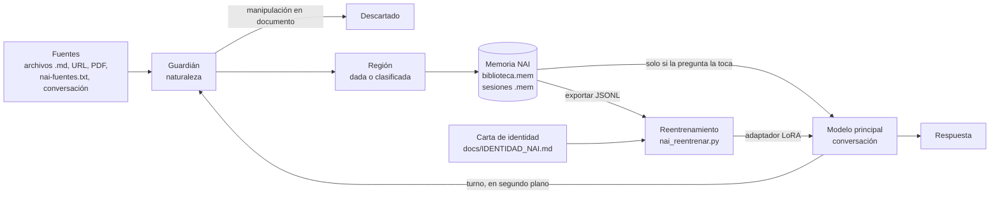
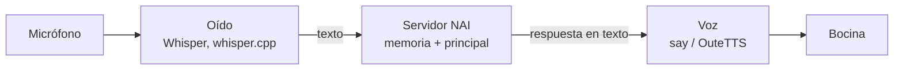
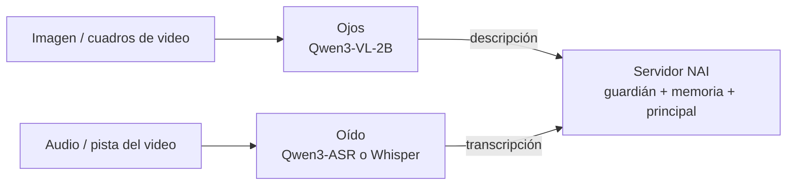
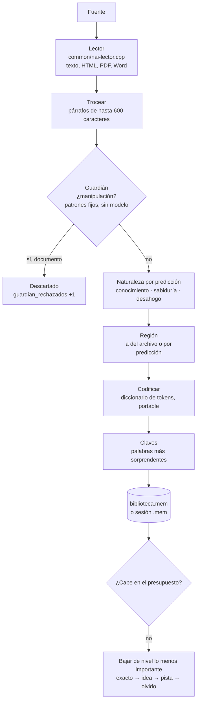
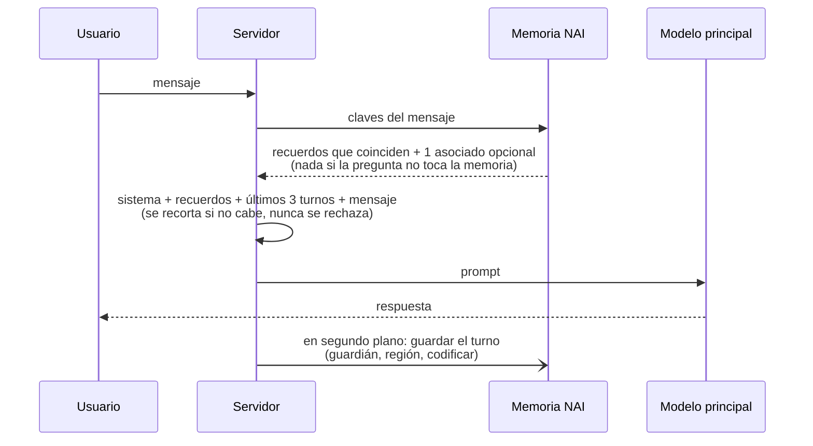
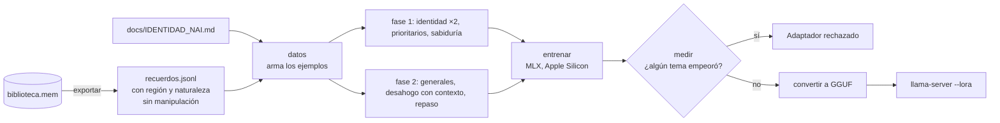

# Ruta de la información en NAI, modelo por modelo

Este documento sigue el camino de la información desde que entra a NAI hasta que se vuelve parte del modelo, e indica qué modelo interviene en cada paso.

**Estado (v7):** NAI puede repartir el trabajo entre varios modelos, como las partes de un cerebro. Cada pieza se activa con su flag; sin ellas, el modelo principal hace todo, como antes. Las rutas no cambian: cambia quién hace cada paso.

| Pieza | Cómo se activa | Estado |
|---|---|---|
| Modelo principal | `-m modelo.gguf` | Funciona |
| Motor de memoria y guardián | `--nai-memoria` | Funciona (en el principal o en el cerebelo) |
| Cerebelo | `--nai-cerebelo modelo.gguf` | Funciona; precisión por medir con modelos reales |
| Hipocampo | `--nai-hipocampo embeddings.gguf` | Funciona; umbral por calibrar con modelos reales |
| Especialista en código | `--nai-especialista URL` | Funciona; sin recuerdos de NAI todavía |
| Borrador especulativo | `-md` con el modelo del cerebelo | Funciona (llama.cpp); velocidad por medir |
| Ojos (imágenes y video) | `--mmproj` en el principal o `--nai-ojos URL` | Funciona con un servidor de prueba; falta medir con Qwen3-VL-2B en la Mac |
| Oído (audio en el chat) | `--nai-oido URL` | Funciona con un servidor de prueba; falta medir con Qwen3-ASR o whisper-server |
| Voz (hablar con NAI) | `tools/nai/nai-voz.sh` | Funciona en pruebas simuladas; falta probarlo con micrófono |
| Identidad LoRA | `nai_reentrenar.py` + `--lora` | El proceso existe; falta entrenarlo |

## 1. Mapa general

## 2. Los modelos y su papel

| Modelo | Parte del cerebro | Qué recibe | Qué produce | Estado |
|---|---|---|---|---|
| **Modelo principal** (1.5–3B instruct) | Corteza: conversar y razonar | Mensaje, recuerdos relevantes, últimos 3 turnos | La respuesta | **Existe** |
| **Motor de memoria** (contexto aparte de 1,024 tokens) | Hipocampo que guarda | Cada trozo nuevo | Región, naturaleza, claves, frase IDEA al olvidar | **Existe**: en el cerebelo si está, si no en el principal |
| **Guardián** (dentro del motor) | Filtro de lo que se aprende | Cada trozo nuevo | Naturaleza: conocimiento, sabiduría, desahogo, manipulación | **Existe**: patrones fijos + predicción |
| **Identidad LoRA** (sobre el principal) | Corteza prefrontal: carácter, ética, empatía | Carta de identidad + biblioteca | Un adaptador que se carga con `--lora` | **Existe** el proceso; falta entrenarlo |
| **Cerebelo** (0.5B instruct) | Automático y predictivo | Trozos nuevos; borradores de la respuesta | El trabajo del motor de memoria; tokens propuestos al principal (especulación); a qué especialista va cada pregunta | **Existe** (`--nai-cerebelo`; especulación con `-md`) |
| **Hipocampo de embeddings** (modelo de embeddings chico) | Asociación por significado | Cada trozo y cada pregunta | Una firma de significado de 32 B: «mascota» encuentra «perro» | **Existe** (`--nai-hipocampo`) |
| **Especialista en código** (1.5B) | Área especializada | Preguntas que el cerebelo le envía | Respuestas de su campo | **Existe** (`--nai-especialista URL`), bajo demanda |
| **Memoria NAI** (no es un modelo) | Cuerpo calloso: lo que todos comparten | Lo que guardan todos | Recuerdos para todos | **Existe** |

## 2b. Modelos concretos y conocimientos de cada uno

La tabla dice qué modelo se propone para cada papel (cada uno se pasa con su flag, §2). Sin flags, el modelo de `-m` hace todos los papeles. Todos son de la familia Qwen para compartir vocabulario (regla 1 y 2, §6), salvo el oído y la voz, que no tocan la memoria.

| Papel | Modelo propuesto (GGUF) | Tamaño q4 aprox. | Conocimientos y tareas que le corresponden |
|---|---|---|---|
| **Principal** (conversación) | Qwen3-4B; con 8 GB justos, Qwen3-1.7B | ~2.5 GB / ~1.1 GB | Las regiones de la vida y del sentido: conciencia, ética, espiritualidad, empatía, psique, filosofía, arte, medicina tradicional, biología, agricultura, supervivencia, finanzas personales, cocina, compras, deportes, trámites, entretenimiento, general. Lleva el LoRA de identidad |
| **Razonamiento** (lógica y cálculo) | El mismo principal en modo razonamiento (Qwen3 lo trae); no ocupa memoria extra | 0 | Lógica, matemáticas, física, química, mecánica, aerodinámica y la parte de cálculo de ingeniería |
| **Especialista en código** (bajo demanda) | Qwen2.5-Coder-1.5B-Instruct | ~1.0 GB | Ciberseguridad técnica (código, configuraciones, análisis), programación e ingeniería de software |
| **Cerebelo** (memoria y reparto) | Qwen3-0.6B | ~0.4 GB | Ningún tema propio: guarda, clasifica región y naturaleza, propone tokens al principal (especulación) y decide a quién va cada pregunta |
| **Hipocampo** (asociación) | Qwen3-Embedding-0.6B (Apache 2.0) | ~0.4 GB | Ningún tema propio: convierte cada recuerdo y cada pregunta en un vector de significado para relacionarlos |
| **Ojos** (imágenes y video) | Qwen3-VL-2B-Instruct como principal (con su `--mmproj`), o aparte con `--nai-ojos` | ~1.8 GB + 0.45 GB (Q8) | Ver fotos, capturas, documentos fotografiados y cuadros de video; describirlos para la memoria y la biblioteca |
| **Oído** (voz a texto) | Qwen3-ASR-0.6B con `--nai-oido`, o Whisper (whisper.cpp; `whisper-server` o `nai-voz.sh`); con 8 GB justos, Whisper small | ~0.8 GB + 0.2 GB / ~0.2 GB | Transcribir lo que hablas, las notas de voz, los audios y la pista de los videos |
| **Voz** (texto a voz) | La voz del sistema (`say` en macOS) para empezar; después OuteTTS 1.0 0.6B | 0 / ~0.4 GB | Leer en voz alta la respuesta de NAI |

Notas:

- **La memoria la comparten todos.** Una región dice de qué trata un recuerdo, no qué modelo lo guarda: cuando el especialista en código responde, también ve los recuerdos de ciberseguridad que aprendió NAI.
- **El principal hace también el razonamiento.** Un modelo de matemáticas aparte costaría más de 1 GB; Qwen3 ya trae un modo de razonamiento paso a paso, así que basta con activarlo para esas regiones.
- **El hipocampo con licencia libre.** jina-embeddings-v5-text-small mide algo mejor en las pruebas multilingües, pero su licencia es no comercial (CC-BY-NC 4.0); Qwen3-Embedding-0.6B es Apache 2.0 y sirve también si NAI llega a AmigoCash.
- **Los nombres y tamaños son la propuesta de noviembre de 2026**: se confirman al implementar cada pieza, midiendo precisión, velocidad y memoria en la Mac.

## 2c. Oído y voz

Los sentidos dentro del servidor (sección 3.9 del README): una imagen, un audio o un video que llega por el chat, por una URL o por `/nai/aprender` se le pasa al principal si él lo entiende; si no, los ojos (`--nai-ojos`) o el oído (`--nai-oido`) lo convierten en texto. Ese texto es lo que guardan la memoria y la biblioteca, y pasa por el guardián como cualquier documento.

La voz para hablar con NAI entra y sale **por fuera** del servidor: el oído convierte el audio en texto antes de entrar y la voz lee la respuesta al salir. La memoria, el guardián y la identidad no cambian. Lo que se guarda es el texto transcrito, no el audio.

| Pieza | Qué hay | Qué falta |
|---|---|---|
| Oído | `tools/nai/nai-voz.sh`: graba con sox hasta que te callas y transcribe con whisper.cpp (Metal en Apple Silicon) | Probarlo con micrófono real |
| Voz | El mismo script lee la respuesta con `say` (voz en español de macOS) o `espeak-ng` (Linux) | OuteTTS 1.0 requiere una versión de `llama-tts` con soporte para su formato nuevo |

## 3. Ruta de aprendizaje (entrada)

| Paso | Sin cerebelo ni hipocampo | Con `--nai-cerebelo` y `--nai-hipocampo` |
|---|---|---|
| Leer y trocear | Código, sin modelo | Igual |
| Detectar manipulación | Patrones fijos, sin modelo | Igual (determinista a propósito) |
| Naturaleza (las otras tres) | Motor de memoria, por predicción | Cerebelo |
| Región | La del archivo; si no, motor por predicción | La del archivo; si no, cerebelo |
| Codificar | Diccionario de tokens del modelo que guarda | Igual, con el vocabulario del cerebelo |
| Claves | Sorpresa medida por el motor | Sorpresa del cerebelo + firma del hipocampo |
| Frase IDEA al olvidar | Motor de memoria (`generar`) | Cerebelo |

**Importancia al olvidar** = factor de naturaleza × [peso de la región × (1 + 0.5 × usos) + 1 / (1 + días sin usarse)], con factor 1.5 para sabiduría, 1 para conocimiento, 0.5 para desahogo y 0.25 para manipulación (solo existe en conversaciones; en documentos se descarta). Lo menos importante se drena primero.

## 4. Ruta de conversación (consulta)

| Paso | Sin cerebelo ni hipocampo | Con `--nai-cerebelo` y `--nai-hipocampo` |
|---|---|---|
| Buscar recuerdos | Claves (palabras), sin modelo | Claves + firma del hipocampo |
| Elegir quién responde | El principal, o el especialista si la pregunta trae código (con `--nai-especialista`) | El cerebelo decide: principal o especialista |
| Generar la respuesta | Modelo principal | Principal con borrador del cerebelo (más rápido) |
| Guardar el turno | Motor, en segundo plano; cede el paso si hay peticiones activas | Cerebelo, en segundo plano |

## 5. Ruta de consolidación (de la memoria a los pesos)

| Naturaleza | Cómo entra al entrenamiento |
|---|---|
| Identidad (la carta) | Fase 1, dos pasadas por época. NAI la cita como lo que su autor le enseñó |
| Sabiduría | Fase 1, con los temas prioritarios |
| Conocimiento | Según el peso de su región |
| Desahogo | Fase 2, peso 1, solo con su contexto: «una persona bajo presión, no una verdad sobre la humanidad»; sin preguntas |
| Manipulación | Nunca |

Además, de cada recuerdo sale un ejemplo que enseña a reconocer su naturaleza, así que el guardián mejora con cada reentrenamiento.

Hoy este proceso se corre a mano (`python3 tools/nai/nai_reentrenar.py todo …`, README §3.6). El plan es dispararlo solo cuando la biblioteca acumule suficiente material nuevo.

## 6. Reglas que no cambian al repartir el trabajo

1. **El vocabulario de la memoria es fijo.** Los recuerdos se guardan como IDs de token del modelo que guarda. Si ese modelo cambia de familia (por ejemplo, de Qwen a Llama), los recuerdos dejan de leerse. Con el cerebelo, él será el dueño fijo de la memoria. Desde v7 la huella de los archivos depende solo del vocabulario: cambiar de 0.5B a 3B, o pasar la memoria al cerebelo de la misma familia, conserva lo aprendido.
2. **La especulación solo funciona dentro de una familia.** El cerebelo y el principal deben compartir vocabulario (por ejemplo, Qwen 0.5B con Qwen 3B).
3. **La manipulación se detecta sin modelo.** Patrones fijos y deterministas: ningún modelo, por grande que sea, decide si se aprende un intento de manipularlo.
4. **La memoria solo se consulta cuando la pregunta la toca.** Lo asociado se ofrece como comentario opcional, nunca como dato impuesto.
5. **Ninguna conversación se bloquea por tamaño.** Si algo no cabe, se recorta; lo recortado ya está en la memoria.

## 7. Memoria en un equipo de 8 GB (estimado)

| Configuración | Modelos cargados | Total aprox. (sin KV) |
|---|---|---|
| **Sin flags** | Un modelo (principal + motor de memoria) | 0.4 GB (0.5B) a 2 GB (3B) |
| **Mínima con voz** | Qwen3-1.7B + Qwen3-0.6B + Qwen3-Embedding-0.6B + Whisper small + `say` | ~2.1 GB |
| **Con sentidos** | Qwen3-VL-2B (principal que ve) + Qwen3-0.6B + Qwen3-ASR-0.6B | ~3.9 GB |
| **Completa** | Qwen3-4B + Qwen3-0.6B + Qwen3-Embedding-0.6B + Whisper turbo + OuteTTS 0.6B | ~4.3 GB; el especialista en código (+1 GB) se carga solo cuando hace falta |

Más el KV de cada modelo. Arranca con `-fitt 2048` para dejar margen al sistema. En 8 GB, la configuración completa queda justa: conviene empezar por la mínima y subir midiendo.
