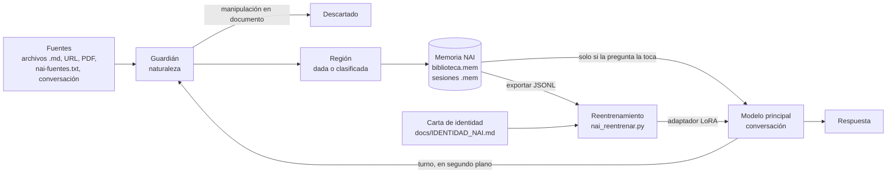
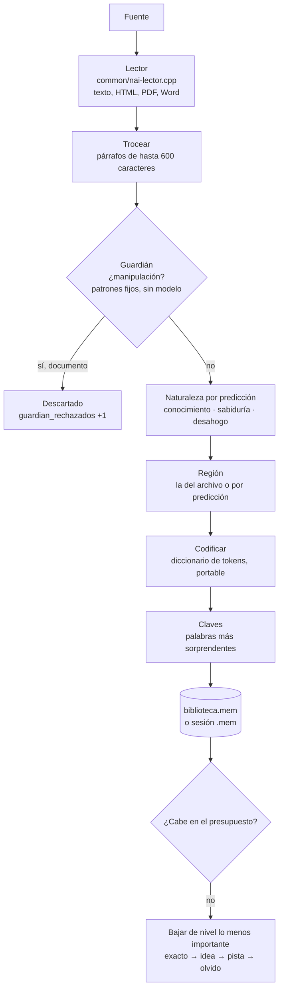
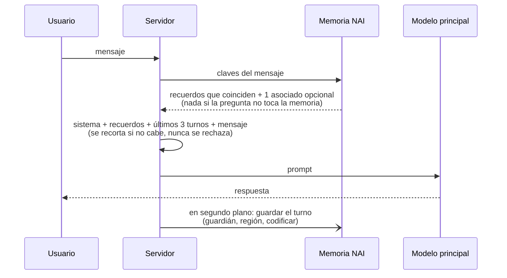
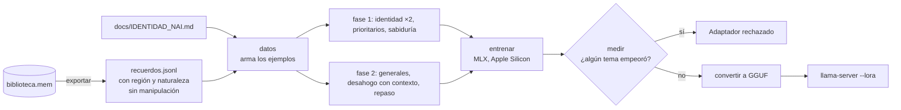

# Ruta de la información en NAI, modelo por modelo

Este documento sigue el camino de la información desde que entra a NAI hasta que se vuelve parte del modelo, e indica qué modelo interviene en cada paso. Distingue lo que **ya existe** de lo que está **planeado** (README §9.5).

**Hoy un solo modelo hace todo**: conversa y, en un contexto aparte de 1,024 tokens (el *motor de memoria*), guarda, clasifica y vigila lo que se aprende. El plan es repartir ese trabajo entre modelos especializados, como las partes de un cerebro, sin cambiar las rutas: cambia quién hace cada paso, no el camino.

## 1. Mapa general

## 2. Los modelos y su papel

| Modelo | Parte del cerebro | Qué recibe | Qué produce | Estado |
|---|---|---|---|---|
| **Modelo principal** (1.5–3B instruct) | Corteza: conversar y razonar | Mensaje, recuerdos relevantes, últimos 3 turnos | La respuesta | **Existe** |
| **Motor de memoria** (hoy: el mismo modelo, contexto aparte) | Hipocampo que guarda | Cada trozo nuevo | Región, naturaleza, claves, frase IDEA al olvidar | **Existe** dentro del principal |
| **Guardián** (dentro del motor) | Filtro de lo que se aprende | Cada trozo nuevo | Naturaleza: conocimiento, sabiduría, desahogo, manipulación | **Existe**: patrones fijos + predicción |
| **Identidad LoRA** (sobre el principal) | Corteza prefrontal: carácter, ética, empatía | Carta de identidad + biblioteca | Un adaptador que se carga con `--lora` | **Existe** el proceso; falta entrenarlo |
| **Cerebelo** (0.5B instruct) | Automático y predictivo | Trozos nuevos; borradores de la respuesta | El trabajo del motor de memoria; tokens propuestos al principal (especulación); a qué especialista va cada pregunta | **Planeado** |
| **Hipocampo de embeddings** (modelo de embeddings chico) | Asociación por significado | Cada trozo y cada pregunta | Un vector de significado: «mascota» encuentra «perro» | **Planeado** |
| **Especialistas** (código, matemáticas; 1.5B) | Áreas especializadas | Preguntas que el cerebelo les envía | Respuestas de su campo | **Planeado**, cargados bajo demanda |
| **Memoria NAI** (no es un modelo) | Cuerpo calloso: lo que todos comparten | Lo que guardan todos | Recuerdos para todos | **Existe** |

## 3. Ruta de aprendizaje (entrada)

| Paso | Lo hace hoy | Lo hará con el plan |
|---|---|---|
| Leer y trocear | Código, sin modelo | Igual |
| Detectar manipulación | Patrones fijos, sin modelo | Igual (determinista a propósito) |
| Naturaleza (las otras tres) | Motor de memoria, por predicción | Cerebelo |
| Región | La del archivo; si no, motor por predicción | La del archivo; si no, cerebelo |
| Codificar | Diccionario de tokens del modelo que guarda | Igual, con el vocabulario del cerebelo |
| Claves | Sorpresa medida por el motor | Sorpresa del cerebelo + vector del hipocampo |
| Frase IDEA al olvidar | Motor de memoria (`generar`) | Cerebelo |

**Importancia al olvidar** = factor de naturaleza × [peso de la región × (1 + 0.5 × usos) + 1 / (1 + días sin usarse)], con factor 1.5 para sabiduría, 1 para conocimiento, 0.5 para desahogo y 0.25 para manipulación (solo existe en conversaciones; en documentos se descarta). Lo menos importante se drena primero.

## 4. Ruta de conversación (consulta)

| Paso | Lo hace hoy | Lo hará con el plan |
|---|---|---|
| Buscar recuerdos | Claves (palabras), sin modelo | Claves + vector del hipocampo |
| Elegir quién responde | Siempre el principal | El cerebelo reparte: principal o especialista |
| Generar la respuesta | Modelo principal | Principal con borrador del cerebelo (más rápido) |
| Guardar el turno | Motor, en segundo plano; cede el paso si hay peticiones activas | Cerebelo, en segundo plano |

## 5. Ruta de consolidación (de la memoria a los pesos)

| Naturaleza | Cómo entra al entrenamiento |
|---|---|
| Identidad (la carta) | Fase 1, dos pasadas por época. NAI la cita como lo que su autor le enseñó |
| Sabiduría | Fase 1, con los temas prioritarios |
| Conocimiento | Según el peso de su región |
| Desahogo | Fase 2, peso 1, solo con su contexto: «una persona bajo presión, no una verdad sobre la humanidad»; sin preguntas |
| Manipulación | Nunca |

Además, de cada recuerdo sale un ejemplo que enseña a reconocer su naturaleza, así que el guardián mejora con cada reentrenamiento.

Hoy este proceso se corre a mano (`python3 tools/nai/nai_reentrenar.py todo …`, README §3.6). El plan es dispararlo solo cuando la biblioteca acumule suficiente material nuevo.

## 6. Reglas que no cambian al repartir el trabajo

1. **El vocabulario de la memoria es fijo.** Los recuerdos se guardan como IDs de token del modelo que guarda. Si ese modelo cambia de familia (por ejemplo, de Qwen a Llama), los recuerdos dejan de leerse. Con el cerebelo, él será el dueño fijo de la memoria.
2. **La especulación solo funciona dentro de una familia.** El cerebelo y el principal deben compartir vocabulario (por ejemplo, Qwen 0.5B con Qwen 3B).
3. **La manipulación se detecta sin modelo.** Patrones fijos y deterministas: ningún modelo, por grande que sea, decide si se aprende un intento de manipularlo.
4. **La memoria solo se consulta cuando la pregunta la toca.** Lo asociado se ofrece como comentario opcional, nunca como dato impuesto.
5. **Ninguna conversación se bloquea por tamaño.** Si algo no cabe, se recorta; lo recortado ya está en la memoria.

## 7. Memoria en un equipo de 8 GB (estimado)

| Modelo | Peso (q4) | Siempre cargado |
|---|---|---|
| Principal 3B | ~1.9 GB | Sí |
| Cerebelo 0.5B | ~0.4 GB | Sí |
| Hipocampo de embeddings | ~0.1–0.3 GB | Sí |
| Un especialista 1.5B | ~1.0 GB | No: se carga cuando hace falta |

Más el KV de cada uno. Arranca con `-fitt 2048` para dejar margen al sistema. Los valores son aproximados: se medirán al implementar cada pieza.
